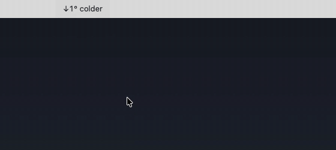

# TempDiff

A tiny macOS menu-bar app that tells you whether it is warmer or colder now than at this hour yesterday: `↑3° warmer than yesterday`, `↓2° colder than yesterday` or `= same as yesterday`.



([MP4 version](docs/menu-demo.mp4))

## Why

Weather apps give you a forecast, but what you usually want to know is how today compares with yesterday. You already know what yesterday felt like, so "2° colder" tells you more than "7°".

- **One glance.** The difference sits in the menu bar, so you never open an app.
- **Same hour, apples to apples.** It compares now with exactly 24 hours later, not daily highs and lows.
- **A bit more on click.** The menu shows yesterday, now and tomorrow, each with conditions and the chance of rain.
- **No account, no API key.** It uses your location and the free [Open-Meteo](https://open-meteo.com) forecast, and refreshes every 30 minutes and when your Mac wakes.

## Download

Grab `TempDiff.zip` from the [latest release](https://github.com/boyanangelov/tempdiff/releases/latest), unzip it and move `TempDiff.app` to Applications.

The app isn't signed with an Apple Developer ID, so macOS blocks it the first time. To open it anyway: right-click the app and choose **Open**, or go to **System Settings ▸ Privacy & Security** and click **Open Anyway**. You can also clear the quarantine flag from a terminal:

```sh
xattr -dr com.apple.quarantine /Applications/TempDiff.app
```

On first launch, allow location access so it can fetch the weather where you are.

## Requirements

- An Apple Silicon Mac (M1 or later) running macOS 13 (Ventura) or later
- To build from source: the Xcode Command Line Tools (`xcode-select --install`)

## Build & run

```sh
./build.sh
open TempDiff.app
```

Temperatures are in °F if your Mac uses US measurements, otherwise °C.

## Start at login

Tick **Start at Login** in the menu. It writes a LaunchAgent (`~/Library/LaunchAgents/io.github.boyanangelov.tempdiff.plist`) pointing at the running copy of the app, and unticking removes it. The change applies from your next login.

Or install it into `~/Applications` and register it for login in one go:

```sh
./install.sh
```

The script prints the uninstall command.

## License

[MIT](LICENSE)
